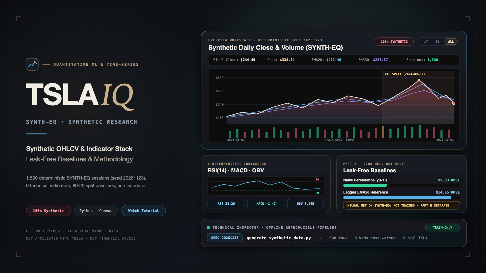

# TSLAIQ Demo — Synthetic Time-Series Analytics & ML Methodology Showcase

[](https://erturkeryavuz.github.io/tslaiq-demo/)

**Live Interactive Showcase (GitHub Pages):** [https://erturkeryavuz.github.io/tslaiq-demo/](https://erturkeryavuz.github.io/tslaiq-demo/)

A sanitized, self-contained static portfolio showcase for **TSLAIQ** by **Ertürk Eryavuz**, built over a **100% synthetic daily equity dataset (`SYNTH-EQ`)** with zero real market data, zero external runtime dependencies, and transparent separation between synthetic demonstration outputs and archival research conclusions.

> **Source Availability, Synthetic Data & Financial Disclaimer**
> - The original Python/Keras time-series research repository (`erturkeryavuz/TSLAIQ`), including its historical datasets, training logs, tests, and model archives, is **private**.
> - This public repository contains **only** the deterministic synthetic data generator (`scripts/generate_synthetic_data.py`), its generated synthetic CSV (`data/synthetic_ohlcv.csv`), the static web showcase (`docs/`), attribution notices, and offline verification checks (`tests/verify_demo.py`).
> - Every chart, indicator, and benchmark metric plotted on the live website is computed exclusively on the fictional **`SYNTH-EQ`** dataset (1,500 weekday sessions, fixed seed `20261123`). **Zero** Yahoo Finance / `yfinance` rows and **zero** real Tesla market observations are included.
> - No live neural-network training or inference runs in this showcase, and no model has been trained on `SYNTH-EQ`.
> - Not affiliated with Tesla, Inc. or Yahoo Finance. **Not live market data. Not financial advice.**

## Synthetic Demonstration vs. Historical Research Record

- **Part A — Synthetic Interactive Demonstration (`SYNTH-EQ`):**
  - Multi-regime geometric random walk with stochastic volatility clustering generated purely via Python stdlib (`random.Random(20261123)`).
  - Interactive OHLCV + volume Canvas chart, synchronized `RSI(14)`, `EMA20`, `EMA50`, `MACD(12,26,9)`, and `OBV` indicator stack, leak-free chronological split (`80/20`, train-only scaler), held-out **Naive Persistence (`$5.83` USD RMSE)** vs. **Lagged EMA20 (`$14.65` USD RMSE)** rolling RMSE comparison, an illustrative deterministic threshold-rule sandbox, and a **9-stage Watch Tutorial** with play/pause, stepping, restart, responsive guided framing, and reduced-motion support.
- **Part B — Archival Private Research Summary (Separate):**
  - In the original private engineering project (conducted on real historical equity data — **not** `SYNTH-EQ`), four historical Keras LSTM / Attention-LSTM training runs were logged.
  - **Key honest conclusion:** None of the historically logged LSTM models demonstrated predictive superiority over the trivial naive persistence baseline (`y[t] = y[t-1]`).
  - Phase A security and methodology hardening in the private codebase eliminated full-dataset scaler leakage (`TrainOnlyMinMaxScaler`), replaced anonymous Keras `Lambda` layers with serializable custom layers, and blocked unsafe `.keras` archive deserialization via static ZIP/JSON inspection. Fresh TensorFlow/Keras retraining under the leak-free split remains unrun locally.

## Reproduce & Verify Offline

```bash
# Regenerate data/synthetic_ohlcv.csv and docs/data.js deterministically (byte-for-byte identical)
python3 scripts/generate_synthetic_data.py

# Run complete offline reproducibility, OHLCV-invariant, zero-real-data, and syntax checks
python3 tests/verify_demo.py

# Preview locally
python3 -m http.server 8080 --directory docs
# Open http://127.0.0.1:8080/
```

## Notices & Provenance

- [docs/THIRD-PARTY-NOTICES.md](docs/THIRD-PARTY-NOTICES.md)
- Live notices page: [https://erturkeryavuz.github.io/tslaiq-demo/notices.html](https://erturkeryavuz.github.io/tslaiq-demo/notices.html)
- Repository cover artwork in `media/` and editable vector sources in `media/src/` (`tslaiq-readme-hero` and `tslaiq-social-preview`) are 100% original vector graphics authored specifically for this showcase using only synthetic `SYNTH-EQ` metrics, with zero third-party photographs, Tesla branding, or real market charts.
